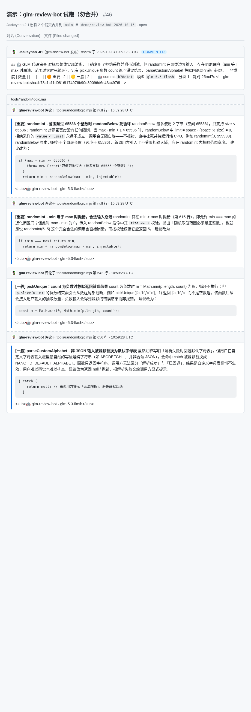
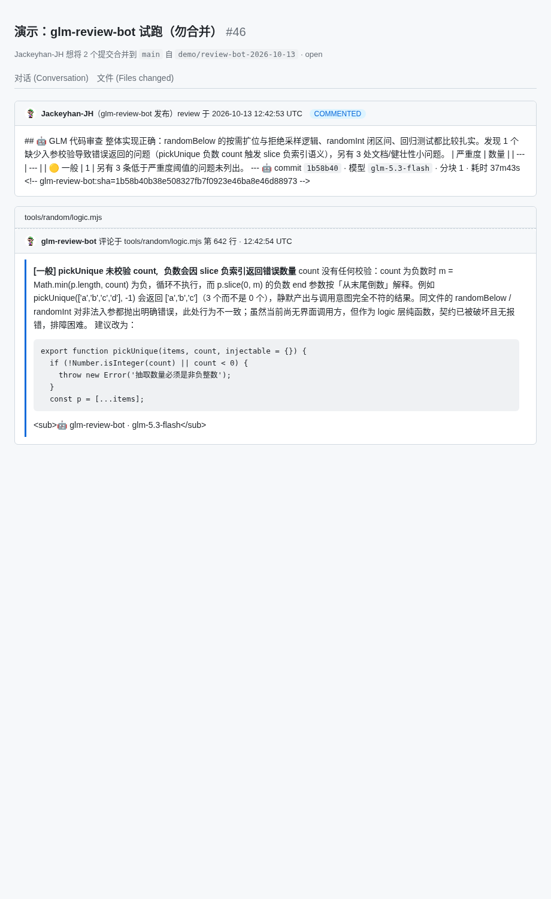
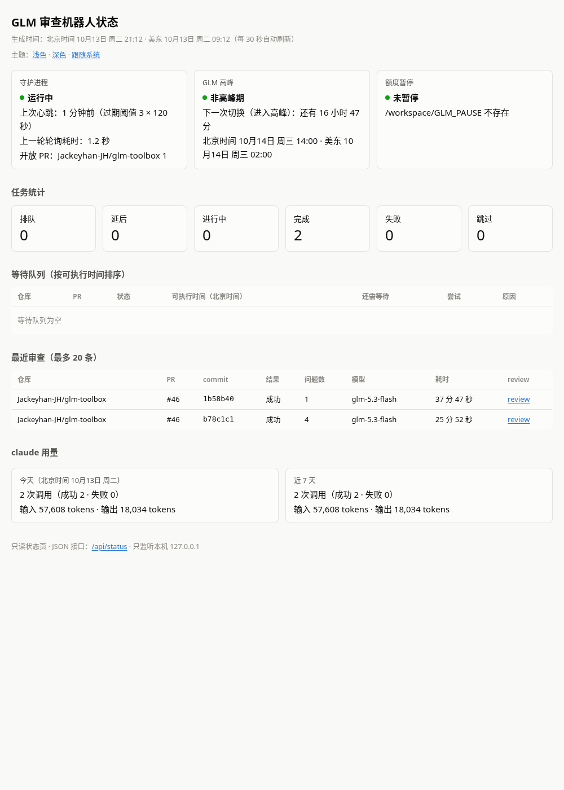
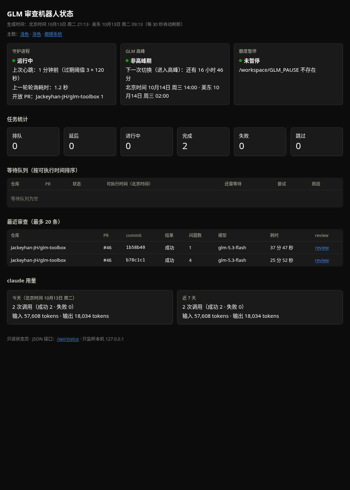

# 真实试跑演示（glm-toolbox）

本文记录 #17 收尾试跑的全过程：在 box 上把机器人装起来、对 `Jackeyhan-JH/glm-toolbox` 的一个真实演示 PR 跑完整审查流程（草稿跳过 → `/glm-review` 手动重审 → 修复 commit 后的去重验证），并如实记录试跑暴露的问题。

## 0. 环境与隔离

试跑没有动机器上已有的真实部署，用的是环境变量覆盖的隔离目录（见 [operations.md](operations.md)）：

| 项 | 值 |
|---|---|
| 配置 | `GLM_REVIEW_CONFIG=~/.config/glm-review-bot/demo.yml` |
| 数据目录 | `GLM_REVIEW_HOME=~/.local/share/glm-review-bot-demo` |
| 白名单 | `repos: [Jackeyhan-JH/glm-toolbox]`（仅此一个仓库） |
| 其余配置 | 默认值（`timeoutSec: 900`、`maxChunkLines: 800`、`skipDrafts: true` 等） |
| 安装方式 | 按 README：`scripts/install.sh`（`~/.local/bin/glm-review` 软链到本仓库） |

时间线均为 **UTC**（北京时间 = UTC+8，美东 = UTC−4）。两次 GLM 调用分别开始于北京时间 18:33 与 20:05，都在工作日高峰（14:00–18:00）之后，`usage` 报表确认高峰调用 = 0。

## 1. 演示 PR 与埋点

- 仓库：`Jackeyhan-JH/glm-toolbox`（私有仓库），分支 `demo/review-bot-2026-10-13`；
- PR [#46](https://github.com/Jackeyhan-JH/glm-toolbox/pull/46)《演示：glm-review-bot 试跑（勿合并）》，草稿开启，改动集中在 `tools/random/logic.mjs`（新增 `randomInt` / `pickUnique` / `parseCustomAlphabet` 三个函数 + 测试，72 行改动）；
- 预埋 3 个问题：① `randomInt` 边界 bug（闭区间漏 `+1`，`min === max` 时崩溃）；② `parseCustomAlphabet` 解析失败静默回退默认字母表（错误处理）；③ `pickUnique` 单字母变量 + 一行三元交换（可读性）。

## 2. 安装后的第一步：dry-run 确认

按 README 装好后先 `daemon --once --dry-run`，确认白名单外不会有任何动作（当时开放 PR 1 个，均不在白名单，无 review 发出）；随后对草稿 PR 跑正式 `--once`，确认草稿被跳过且零调用：

```console
$ glm-review daemon --once
glm-review daemon 启动（--once 单轮模式）。
○ 轮询完成（1070ms）：开放 PR 1，入队 0，跳过 1，被新 commit 取代 0。
```

状态库里落了 `skipped(draft)` 记录（不算已审，转正后同 sha 可重新入队），`calls` 表零行——没有花一次 GLM 调用。

## 3. `/glm-review` 手动重审 → 第一条 review

在 PR 上评论 `/glm-review`，再跑 `daemon --once`（北京时间 18:33 开始，峰后）：

```console
$ glm-review daemon --once
glm-review daemon 启动（--once 单轮模式）。
○ 轮询完成（…ms）：开放 PR 1，入队 1，跳过 0，被新 commit 取代 0。
▶ 开始审查 Jackeyhan-JH/glm-toolbox#46（b78c1c1）（第 1 次尝试）
→ 获取 PR 信息 → … → 调用模型审查（第 1/1 块）→ 组装并发布 review
✔ Jackeyhan-JH/glm-toolbox#46（b78c1c1） 审查完成：…#pullrequestreview-5502492931（4 条问题，模型 glm-5.3-flash）
```

> 仓库是私有仓库，截图由 GitHub API 取回的真实数据本地渲染（内容与 GitHub 页面一致）。



### 命中率

| 埋点 | 是否命中 | 实际发现 |
|---|---|---|
| ① `randomInt` 边界 bug | ✅ 命中 ×2 | `[重要]` min === max 时抛错崩溃；`[重要]` 范围 > 65536 时 `randomBelow` 死循环（第二个是埋点代码无意引入的**额外真 bug**，同样被抓住） |
| ② `parseCustomAlphabet` 静默回退 | ✅ 命中 | `[一般]` 非 JSON 输入被静默替换为默认字母表，建议显式报错或返回明确结果 |
| ③ `pickUnique` 可读性 | ❌ 未命中 | 可读性建议（单字母变量、三元交换）未出现在输出里；但同一函数抓到一个 `[一般]` 真 bug：`count` 为负数时 `slice(0, 负数)` 按倒数语义返回错误长度的数组 |

- 命中 **2/3 ≥ 要求的 2 条**（①②命中，③未命中）；4 条发现全部是真问题，**误报 0 条**，如实记录；
- 行内评论落在 `tools/random/logic.mjs` 第 618（×2）/ 631 / 645 行，全部是本 PR 新增行，未评论未改动行。

### 试跑暴露的问题（如实记录）

**同 sha 出现两条内容完全相同的 review**（10:48:31 与 10:59:28 各一条）。排查确认本机只发布了一条（状态库 1 job / 1 call、日志一次 publish、`--once` 单轮单领取；全盘无第二个实例、无 cron / systemd / Actions 部署）。两条内容逐字节相同、锚定同一开始时刻，最可能是**另一个使用同账号 token 的部署**也对同一条 `/glm-review` 评论做了手动重审——`/glm-review` 按设计忽略 PR 标记去重（#12），多部署环境下必然各发一条，跨部署幂等缺失是产品缺口，已开 [#41](https://github.com/Jackeyhan-JH/glm-review-bot/issues/41) 跟进。处理：较早那条无法删除（GitHub API 只允许删 pending review），已把总评改为「已作废」声明并折叠其 4 条行内评论，保留与本机状态库对应的一条。

另观察到 claude 子进程墙钟远大于其内部会话计时（见下表），且 900 秒超时定时器未触发——疑似 box 进程停摆/限流，结果仍为成功（exit 0），`耗时` 页脚按墙钟计算因此偏大。此现象不影响正确性，记录备查。

## 4. 修复 commit → 新 sha 各审一次 + 去重验证

推送修复 commit `1b58b40`（`randomInt` 补 `+1` 取到闭区间上界、`randomBelow` 按需扩位不再死循环，附回归测试），把 PR 转正后再跑 `--once`（北京时间 20:05，非高峰）：

```console
$ glm-review daemon --once
○ 轮询完成（…ms）：开放 PR 1，入队 1，跳过 0，被新 commit 取代 0。
▶ 开始审查 Jackeyhan-JH/glm-toolbox#46（1b58b40）（第 1 次尝试）
✔ …#pullrequestreview-5503664858（1 条问题，模型 glm-5.3-flash）
```



第二条 review 确认了修复（「randomBelow 的按需扩位与拒绝采样逻辑、randomInt 闭区间、回归测试都比较扎实」），并再次抓到仍未修复的 `pickUnique` 负数 `count` 问题——上一轮的 randomInt 两条 `[重要]` 不再出现，说明审查紧跟最新代码。

紧接着**原样再跑一次** `--once`，去重生效、零 GLM 调用：

```console
$ glm-review daemon --once
○ 轮询完成（1240ms）：开放 PR 1，入队 0，跳过 0，被新 commit 取代 0。
```

状态库证据（`calls` 恰两行，旧 sha 的 job 原样 `done`、attempts 仍为 1，未被重审）：

| job | commit | reason | status | attempts | findings | review |
|---|---|---|---|---|---|---|
| 1 | `b78c1c1` | manual | done | 1 | 4 | …#pullrequestreview-5502492931 |
| 3 | `1b58b40` | ready | done | 1 | 1 | …#pullrequestreview-5503664858 |

## 5. status / usage

```console
$ glm-review status
GLM 审查机器人状态
生成时间：北京时间 10月13日 周二 21:11 / 美东 10月13日 周二 09:11（America/New_York）

守护进程：运行中（26 秒前更新，过期阈值 3 × 120 秒）
  上一轮轮询耗时：1.2 秒
  开放 PR：Jackeyhan-JH/glm-toolbox 1
GLM 高峰：当前非高峰期；下一次切换（进入高峰）：北京时间 10月14日 周三 14:00 / 美东 10月14日 周三 02:00，还有 16 小时 48 分
额度暂停：未暂停（/workspace/GLM_PAUSE 不存在）

任务统计：排队 0 · 延后 0 · 进行中 0 · 完成 2 · 失败 0 · 跳过 0（共 2）

最近审查（最多 20 条）：
  仓库                      PR   commit   结果  问题数  模型           耗时         review
  Jackeyhan-JH/glm-toolbox  #46  1b58b40  成功  1       glm-5.3-flash  37 分 47 秒  https://github.com/Jackeyhan-JH/glm-toolbox/pull/46#pullrequestreview-5503664858
  Jackeyhan-JH/glm-toolbox  #46  b78c1c1  成功  4       glm-5.3-flash  25 分 52 秒  https://github.com/Jackeyhan-JH/glm-toolbox/pull/46#pullrequestreview-5502492931
```

```console
$ glm-review usage --since 24h
用量报表（套餐：新版积分套餐，分组：日期）
统计范围：2026-10-12T13:11:59.452Z ～ 2026-10-13T13:11:59.452Z（当前时刻），共 2 次调用

日期        调用   成功   失败   成功率   平均耗时    总耗时       输入token   输出token   费用($)   折合prompt   高峰调用
2026-10-13   2     2     0     100.0%   6 分 47 秒   13 分 34 秒   57608      18034      0.7486   1           0
总计        2     2     0     100.0%   6 分 47 秒   13 分 34 秒   57608      18034      0.7486   1           0
```

状态页（`glm-review status --serve`）截图：





### 两次调用汇总

| 调用 | commit | 开始（北京） | claude 内部耗时 | 墙钟 | 输入 token | 输出 token | 费用 | 高峰 |
|---|---|---|---|---|---|---|---|---|
| 1 | `b78c1c1` | 18:33:40 | 7 分 29 秒 | 25 分 47 秒 | 45,025 | 8,961 | $0.4491 | 否 |
| 2 | `1b58b40` | 20:05:10 | 6 分 04 秒 | 37 分 43 秒 | 12,583 | 9,073 | $0.2994 | 否 |
| 合计 | — | — | 13 分 34 秒 | — | 57,608 | 18,034 | $0.7486 | **0 次** |

（折合 prompt = 1，均为 `glm-5.3-flash`、单块审查、成功。）

## 6. 演示仓库清理

- PR #46 已**关闭**（未合并），分支 `demo/review-bot-2026-10-13` 已删除；
- glm-toolbox `main` HEAD 保持 `52109bd`（试跑前后的 HEAD 相同，无新提交），Pages 最近一次构建仍是 10-09 的（demo 分支不触发部署），issues 未受影响。

## 7. 验收复跑指南

验收 bot 可按本节独立复跑第 3 步（可以新开一个演示 PR，跑完同样关闭）。全程只需对 `Jackeyhan-JH/glm-toolbox` 有写权限的 gh 登录态与本仓库代码：

```bash
# 1) 隔离安装（不动机器上的真实部署）
cd /workspace/glm-review-bot && scripts/install.sh
cat > ~/.config/glm-review-bot/demo.yml <<'YAML'
repos: [Jackeyhan-JH/glm-toolbox]
statusPort: 43171
YAML
export GLM_REVIEW_CONFIG=~/.config/glm-review-bot/demo.yml
export GLM_REVIEW_HOME=~/.local/share/glm-review-bot-demo

# 2) 新建演示分支 + 小改动（建议在某个工具的 logic.mjs 加一个小函数，
#    埋 1 个边界 bug、1 个错误处理问题、1 个可读性小问题）
git checkout -b demo/review-bot-$(date +%F) && git push -u origin HEAD

# 3) 开「草稿」PR（标题含 勿合并），先确认不会误审：
glm-review daemon --once --dry-run   # 应显示跳过/入队 0，无 review
glm-review daemon --once             # 草稿被跳过（skipped(draft)），0 次 GLM 调用

# 4) 在 PR 上评论 /glm-review 触发手动重审（工作日请在北京时间 18:00 后），
#    然后：
glm-review daemon --once             # 恰好一条 COMMENT review（总评 + 行内评论）
glm-review daemon --once             # 再跑一次：入队 0，零 GLM 调用（去重）

# 5) push 一个修复 commit → glm-review daemon --once → 新 sha 恰好一条 review；
#    再 --once 一次验证零调用；随后收尾：
glm-review status && glm-review usage --since 24h
gh pr close <PR> && git push origin --delete demo/review-bot-$(date +%F)
```

判定要点：每个 commit 恰好一条带 `<!-- glm-review-bot:sha=… -->` 标记的总评；行内评论只落新增行；草稿阶段零调用；同一 sha 重复 `--once` 不再产生 review（`calls` 表行数不变）；`usage` 高峰调用 = 0。
